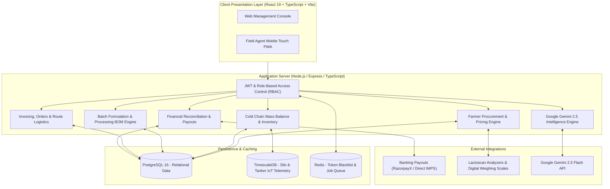

# DairyOS Enterprise ERP — Production Implementation Roadmap

This document outlines the end-to-end multi-phase architecture and implementation plan for transforming DairyOS from an in-memory client-side application into an enterprise-grade, production-ready Dairy Operations Management System.

## Current Implementation Status

| Phase | Description | Deliverables | Status |
| :--- | :--- | :--- | :--- |
| **Phase 0** | Comprehensive Gap & Bug Fixes | Blank screen fixes, ErrorBoundary, BOM packaging formulas, settings, reports export | **Completed (100%)** |
| **Phase 1** | Backend Foundation & Database | Express API server, Prisma ORM schema (16 entities), seed pipeline (32 farmers, 52 cattle, etc.) | **Completed (100%)** |
| **Phase 2** | Enterprise Authentication & Procurement | JWT sessions, bcrypt hashing, RBAC middleware, 2-axis rate calculation, API client sync | **Completed (100%)** |
| **Phase 3** | Cold Silos & Mass Balance | Inter-tank transfers, transactional batch formulation, continuous volumetric mass-balance engine | **Completed (100%)** |
| **Phase 4** | Commercial Sales & Invoicing | Sales orders, GST Tax Invoices (HSN 0401/0405/0406), automated batch IMPS banking disbursements | **Completed (100%)** |
| **Phase 5** | Hardware IoT, Gemini AI & DevOps | Lactoscan/silo MQTT ingestion, Gemini 2.5 AI forecasting & ration balancer, Docker & compose | **Completed (100%)** |

---

## Architecture Overview

---

## Phase 1: Backend Foundation & Database Architecture (Weeks 1-2)
**Goal:** Establish the foundational backend directory structure, Express server, database connection, ORM schemas, and data seed migrations.

### Key Deliverables:
1. **Server Core Structure:**
   - Dedicated `server/` directory with TypeScript, Express, dotenv, cors, and error handlers.
   - Centralized configuration and environment loader.
2. **Database Engine & ORM:**
   - Setup Prisma ORM connecting to PostgreSQL (with local SQLite fallback for isolated development).
   - Migration runner and database connection pooling.
3. **Core Database Entities:**
   - `User`, `Facility`, `Farmer`, `Cattle`, `FeedItem`, `MilkCollectionRecord`, `QualityTestRecord`, `ChillingTank`.
4. **Seed Pipeline:**
   - Seed script migrating the 52 cattle records, 32 farmers, feed items, and chilling tanks into the database.
5. **Base API Health Check & Operational Metrics:**
   - `GET /api/v1/health`
   - `GET /api/v1/meta/facilities`

---

## Phase 2: Authentication, Security & Farmer Procurement APIs (Weeks 3-4)
**Goal:** Secure the system with enterprise authentication and build robust procurement APIs.

### Key Deliverables:
1. **Security & Authentication:**
   - Password hashing using `argon2` or `bcryptjs`.
   - JWT authentication tokens with HTTP-Only cookie storage and refresh token rotation.
   - RBAC middleware supporting roles: `CEO`, `COO`, `Operations Manager`, `Plant Manager`, `Procurement Manager`, `Finance Manager`, `Field Staff`.
2. **Farmer Directory & KYC APIs:**
   - `GET /api/v1/farmers` (pagination, cluster filtering, search).
   - `POST /api/v1/farmers` (farmer registration with bank account & IFSC validation).
   - `GET /api/v1/farmers/:id/ledger` (historical milk supply and payouts).
3. **Milk Collection & Two-Axis Pricing Engine:**
   - `POST /api/v1/collections` (inward milk record with server-side validation of fat, SNF, and temperature).
   - Automatic server-side two-axis rate calculation: $\text{Rate} = \text{Base} + (\text{Fat} - 4.0) \times M_{\text{fat}} + (\text{SNF} - 8.5) \times M_{\text{snf}}$.
   - Atomic database transactions updating farmer balances and silo volumes.
4. **Frontend Integration:**
   - Connect `LoginScreen.tsx`, `MilkCollectionPage.tsx`, `MobileFieldView.tsx`, and `FarmerManagementPage.tsx` to live backend APIs.

---

## Phase 3: Cold Silos, Processing & Mass Balance Engine (Weeks 5-6)
**Goal:** Establish end-to-end physical mass balance and production batching.

### Key Deliverables:
1. **Chilling Silo Inventory & Telemetry:**
   - `GET /api/v1/chilling/tanks` (live volume, temperature, and cleaning status).
   - `POST /api/v1/chilling/transfer` (inter-tank transfer & silo-to-plant allocation).
2. **Mass-Balance Volumetric Reconciliation Service:**
   - Mathematical model verifying:
     $$\text{Closing} = \text{Opening} + \text{Production}_{\text{herd}} + \text{Procurement}_{\text{farmers}} - \text{Rejections} - \text{Processing} - \text{Spillage}$$
   - Variance detection and automatic alerts when physical discrepancy exceeds 0.5%.
3. **Processing Batch Formulation & Dynamic BOM:**
   - `POST /api/v1/processing/batches` wrapped in an atomic database transaction:
     - Deducts milk from source cold silo.
     - Credits finished goods inventory according to selected recipe.
     - Deducts packaging materials (film, bottles, cups) and logs line scrap.
4. **Frontend Integration:**
   - Connect `ChillingMilkPoolPage.tsx`, `ProcessingPage.tsx`, `PackagingManagementPage.tsx`, and `InventoryPage.tsx` to live backend endpoints.

---

## Phase 4: Commercial Sales, Invoicing & Financial Payouts (Weeks 7-8)
**Goal:** Connect sales orders, invoicing, delivery distribution, and banking payouts.

### Key Deliverables:
1. **Commercial Sales & PDF Invoicing:**
   - `POST /api/v1/sales/orders` (omni-channel orders: Distributor, Supermarket, Horeca).
   - Server-side tax invoice PDF generation with HSN codes (`0401`, `0402`, `0405`) and GST breakdown (CGST, SGST, IGST).
2. **Distribution & Fleet Tracking:**
   - `GET /api/v1/distribution/routes` (route schedules, assigned drivers, and vehicle numbers).
   - Electronic proof-of-delivery (e-POD) record updates.
3. **Farmer Payouts & Banking Gateway:**
   - `GET /api/v1/payments/pending` (pending disbursement queue).
   - Webhook & payout integration (RazorpayX / Cashfree Payouts API) for automated IMPS/UPI farmer settlements.
4. **All-11 Enterprise Reporting Engine:**
   - Server-side stream generation of CSV and Excel workbooks for all 11 reports with date range filtering.

---

## Phase 5: Hardware IoT, Gemini 2.5 Intelligence & Cloud Deployment (Weeks 9-10)
**Goal:** Production cloud deployment, IoT hardware connectivity, and real AI analytics.

### Key Deliverables:
1. **Hardware & IoT Ingestion:**
   - Serial port / Bluetooth bridge for Lactoscan milk analyzers and digital load cells.
   - MQTT broker for continuous thermal telemetry from cold silos.
2. **Google Gemini 2.5 Flash AI Service:**
   - Predictive 72-hour farmer procurement forecasting based on historical trends and weather.
   - Feed ration balancing optimization (least-cost ration formulation).
   - AI-driven mass-balance variance anomaly detector.
3. **Production Containerization & DevOps:**
   - Multi-stage `Dockerfile` for React frontend (served via Nginx) and Node.js backend.
   - `docker-compose.yml` orchestrating PostgreSQL, TimescaleDB, Redis, and API Server.
   - CI/CD workflow with GitHub Actions for automated linting, testing, and deployment to Cloud Run / AWS ECS.
