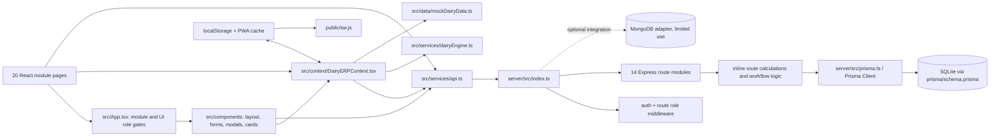
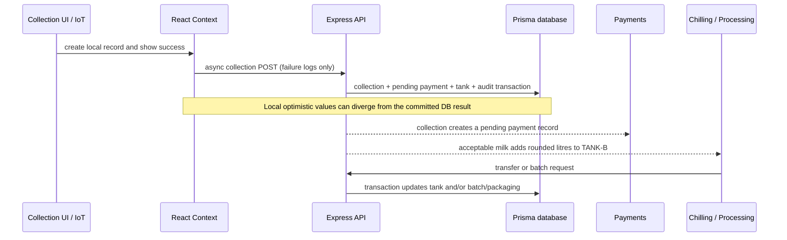

# DairyOS Architecture and Dependency Graph

## Current runtime graph

**Important current mismatch:** `docker-compose.yml` declares PostgreSQL and Redis services and gives the API a PostgreSQL URL, while `prisma/schema.prisma` declares SQLite. The current provider configuration and container deployment are incompatible. Redis is declared but no Redis client/session use was found. No Prisma migration directory is checked in; seed and `prisma db push` are the schema setup path.

## Reverse dependencies and shared logic

| Shared dependency | Reverse dependencies / coupling |
| --- | --- |
| `DairyERPContext` | Most pages consume it; it owns module lists, toast state, localStorage hydration, backend hydration, cross-module operations, local audit entries, and many mutation callbacks. Pages depend on its domain-wide interface rather than narrower services. |
| `src/services/api.ts` | Context hydration/mutations plus direct API calls from Login, AI, Chilling, invoice, tanker clearance, Lactoscan, thermal receipt, and payout components. Several API methods/routes exist without a page using them. |
| `src/services/dairyEngine.ts` | Dashboard, finance, reports, control tower, and AI insights derive metrics from context data. Some are computed from seed/local data rather than authoritative backend aggregates. |
| `src/data/mockDairyData.ts` | Context defaults, page tables/charts, modal demos, and fallback analytics share a large static dataset. Not all values are marked in the interface as simulated. |
| Route-level Prisma code | Each Express route combines request parsing, validation, calculations, transactions, persistence, and audit record creation. There is no separate domain service layer. This is a modular monolith in deployment shape, but current domain boundaries are thin. |
| `public/sw.js` | `index.html` registers it; it caches navigations/assets. API requests bypass caching. Mobile field queue is separately managed in localStorage and is not connected to service worker sync. |

No circular imports were confirmed in the files inspected. There are broad coupling and state ownership issues rather than an observed circular dependency. This is a source-level finding; no dedicated cycle detector was run.

## Cross-module workflows and authoritative ownership

### Domain relationships seen in Prisma

- `Farmer` has a unique `farmerCode` and a one-to-many relationship with `MilkCollectionRecord`; collection `farmerId` references `farmerCode`.
- `MilkCollectionRecord` stores quantity, FAT, SNF, temperature, quality, rate, payable, society and BMC identifiers.
- `PaymentTransaction` is separate from collection and is not linked by a foreign key or collection ID. Reconciliation relies on names/amount totals in places.
- `ChillingTank` stores an aggregate volume; transfers and processing consume it transactionally, while collection intake can round up and cap tank volume.
- `ProcessingBatch` records input and costs; batch route can deduct silo milk and packaging, but does not persist finished product output into `InventoryItem`.
- `SalesOrder` stores order totals/payment/fulfillment flags; no relational link to inventory movements or payments.
- `AuditLogEntry` is a general text event with no actor foreign key or guaranteed link to an atomic mutation.
- Most models do not have a cooperative/facility foreign key. Some use optional static `societyId`/`bmcId` strings; `User` has no organization scope.

## Duplicate logic and misleading state

- Milk pricing formula appears independently in `mockDairyData.ts`, `QuickCollectionModal.tsx`, `MobileFieldView.tsx`, `LactoscanSerialBridgeModal.tsx`, `server/src/routes/collections.ts`, and `server/src/routes/iot.ts`. Rounding differs (`Math.round` versus two-decimal payable), and FAT/SNF/quality thresholds vary in implementation.
- Farmer payable, finance totals, reconciliation, and dashboard KPIs are separately calculated in UI services, context, and routes. The authoritative unit and reporting period are not consistently defined.
- Context writes local state and emits success/audit messages before backend confirmation for collections, farmers, cattle, batches, sales, quality, payments, and tank transfer. Some failures only write `console.warn`.
- `recordMilkCollection` posts to `/collections`, whose backend creates the authoritative record and associated pending payment; the client also creates its own payment and tank update. Hydration may replace state later, while a failed request leaves local success intact.
- Settings pricing values exist in context but calculation sites use literals, so changing settings does not establish an authoritative pricing policy.
- API routes for reproduction, vaccinations, IoT, notifications, quality certification, and sales dispatch exist, but source-level call sites are limited or the current page still uses context/local state. A route's existence does not prove a screen's workflow uses it.

## Target direction

Use the current React/TypeScript/Express/Prisma stack as a modular monolith. Keep presentation components out of persistence decisions. Move shared domain rules (pricing, quality grading, mass balance, inventory movement, payable ledger) into typed domain functions/services called by routes and tested independently. Treat API results as authoritative for online mutations; represent pending/offline work with explicit operation state. Use Prisma transactions for multi-record invariants, unique idempotency keys for retried commands, and explicit cooperative/facility scope in every authorized query. See [IMPLEMENTATION_ROADMAP.md](IMPLEMENTATION_ROADMAP.md).
